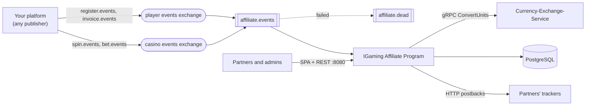

<div align="center">

# IGaming Affiliate Program

**Self-hosted affiliate program for casinos and sportsbooks: campaigns, CPA and revenue share, S2S postbacks,
payouts, driven purely by events.**

[](LICENSE)
[](https://kotlinlang.org)
[](https://github.com/nekzabirov/IGaming-Affiliate-Program/actions/workflows/ci.yml)

</div>

## Why

Affiliate software for gambling usually wants to sit inside your platform: SDKs in your casino, callbacks into
your wallet, your player database copied into theirs. This one only listens. Your platform publishes four plain
JSON events to RabbitMQ (a registration, an invoice, a casino spin, a sportsbook bet), and the program attributes
players to partners, accrues commissions, tells the partners' trackers and pays out. Nothing in it knows or calls
your platform, so it works with any stack that can publish JSON.

## Features

- **Partner cabinet** (Vue 3 SPA served by the app): sign-up, companies (campaigns) with ready links, players,
  daily statistics, earnings ledger, postbacks, payouts, promo materials.
- **Admin review**: partners propose terms, admins approve companies and set final terms, block partners.
- **Commission models**: CPA (once per player, with a minimum first deposit), revenue share of deposits, revenue
  share of real-money turnover; terms of 0 for partners paid up front.
- **Exactly-once accounting on an at-least-once bus**: idempotency keys in the same transaction as the effects,
  any arrival order (deposit before registration, rollback before stake), rollbacks that take back exactly what
  was added.
- **S2S postbacks** to Keitaro on registration, deposit, casino spin and sports bet, with the deposit or the whole
  stake in EUR as the payout, after the commit, with an SSRF guard checked at save time and at connect time.
- **Crypto payouts** in one partner currency (USDT by default) on configurable networks with address validation;
  the amount is reserved at request time.
- **Strict, observable event consumption**: one durable queue, manual acks, every failure dead-lettered with a
  logged cause and replayable; JSON logs with stable `event` keys, Prometheus metrics.
- **Multi-currency**: events in any currency are converted once, on the way in, by
  [Currency-Exchange-Service](https://github.com/nekzabirov/Currency-Exchange-Service).

## Architecture



One Kotlin + Spring Boot 4 service (plain SQL over `JdbcClient`, Flyway, Spring AMQP) with the SPA built into its
jar. Details: [Architecture](https://github.com/nekzabirov/IGaming-Affiliate-Program/wiki/Architecture).

## Quick start

Requires Docker with Compose v2.

```bash
git clone https://github.com/nekzabirov/IGaming-Affiliate-Program.git
cd IGaming-Affiliate-Program
docker compose up --build -d
```

This starts PostgreSQL, RabbitMQ, Currency-Exchange-Service (built from its public repository, with its own
database, migration and seed), runs the app's migrations (`schema`) and starts the app:

- cabinet and API: http://localhost:8080
- metrics and health: http://localhost:9464/metrics, http://localhost:9464/health
- RabbitMQ management: http://localhost:15680 (guest / guest)

Then sign up in the cabinet, make yourself an admin, create and approve the company `summer`, and publish the
sample events:

```bash
docker compose exec postgres psql -U postgres -d affiliate \
  -c "UPDATE account SET role = 'ADMIN', updated_at = now() WHERE login = 'you'"
scripts/publish-sample-events.sh
```

Step by step: [Getting Started](https://github.com/nekzabirov/IGaming-Affiliate-Program/wiki/Getting-Started).

## Requires Currency-Exchange-Service

**Requires [Currency-Exchange-Service](https://github.com/nekzabirov/Currency-Exchange-Service)** for events in a
currency other than `PARTNER_CURRENCY`. The app calls one RPC, `currency.v1.CurrencyService/ConvertUnits`
(contract vendored in `src/main/proto/currency/v1/currency.proto`), with a 3 s deadline and one retry on
`UNAVAILABLE`, before the database transaction. Configure it with `CURRENCY_GRPC_HOST`, `CURRENCY_GRPC_PORT` and
`CURRENCY_GRPC_PLAINTEXT`. **Amounts already in `PARTNER_CURRENCY` never call it**, so a deployment whose events all
arrive in the partner currency runs without it. A refusal (`x-error-code`, e.g. `RATE_MISSING`) dead-letters the
event. See [Currency Conversion](https://github.com/nekzabirov/IGaming-Affiliate-Program/wiki/Currency-Conversion).

## Events

The full contract, with field tables and JSON Schemas (`docs/events/*.schema.json`), is in
[Events](https://github.com/nekzabirov/IGaming-Affiliate-Program/wiki/Events). Any service publishing this JSON
works.

| Exchange (env, default) | Routing key | Acted on | Acknowledged without effect |
|---|---|---|---|
| player events exchange (`PAM_EXCHANGE`, `pam.events`) | `register.events` | a player whose `affiliateTag` is `partner:<identity>` of an active company | any other tag |
| player events exchange | `invoice.events` | `type` `CREDIT` with `status` `SUCCESS` and `amount` > 0 | other types and statuses |
| casino events exchange (`CASINO_EXCHANGE`, `casino.events`) | `spin.events` | `PLACE` (stake), `ROLLBACK` of a `PLACE` | `SETTLE`, other types |
| casino events exchange | `bet.events` | `BET` (stake), `ROLLBACK` of a `BET` | `WIN`, other types |

- Envelope: `{"playerId": <positive JSON integer>, "data": {...}}`; `playerId` must equal the player inside `data`.
  Amounts are signed int64 nano units (1e-9). Extra fields are ignored; `content-type` is ignored.
- Topology, declared by the app: one durable queue `EVENT_QUEUE` (`affiliate.events`) bound to the four routes,
  with `x-dead-letter-exchange=affiliate.dlx` (fanout) -> `affiliate.dead`. The dead-letter TTL is a broker policy
  you configure (at most 14 days).
- Manual ack after the handler returned; any failure (malformed body, wrong `playerId`, database or currency
  service down) is logged as `broker.handler_failed` and nacked without requeue into `affiliate.dead`. No retries.
- Idempotency keys `register:<playerId>`, `invoice:<id>`, `spin:<id>`, `bet:<id>`; any arrival order works.
- Replay: move dead letters back to `affiliate.events` through the default exchange; the route is recovered from
  `x-death`.
- AMQP header `x-request-id` becomes the `traceId` of the event's log lines and postbacks.
- `scripts/publish-sample-events.sh` publishes the examples in `docs/events/examples/` through the management API.

## Configuration

Every variable the app reads, with its default. Details:
[Configuration](https://github.com/nekzabirov/IGaming-Affiliate-Program/wiki/Configuration).

| Env | Default | Meaning |
|---|---|---|
| `SERVER_PORT` | `8080` | public port: the SPA and `/api` |
| `METRICS_PORT` | `9464` | management port: `/metrics` and `/health`; never publish it |
| `DB_URL` | `jdbc:postgresql://localhost:5432` | PostgreSQL host part, without the database |
| `DATABASE_NAME` | `affiliate` | the database (must exist) |
| `DB_USERNAME`, `DB_PASSWORD` | `postgres`, `postgres` | |
| `DB_POOL_SIZE` | `5` | |
| `RABBIT_HOST`, `RABBIT_PORT` | `localhost`, `5672` | |
| `RABBIT_USER`, `RABBIT_PASSWORD` | `guest`, `guest` | |
| `RABBIT_SSL_ENABLED` | `false` | AMQPS |
| `RABBIT_PREFETCH` | `32` | |
| `PAM_EXCHANGE` | `pam.events` | the player events exchange |
| `CASINO_EXCHANGE` | `casino.events` | the casino events exchange |
| `EVENT_QUEUE` | `affiliate.events` | the work queue |
| `CURRENCY_GRPC_HOST`, `CURRENCY_GRPC_PORT` | `localhost`, `443` | Currency-Exchange-Service |
| `CURRENCY_GRPC_PLAINTEXT` | `false` | `true` for plaintext gRPC |
| `PARTNER_CURRENCY` | `USDT` | currency of every balance, commission and payout |
| `CPA_MIN_DEPOSIT` | `10` | minimum first deposit for CPA, in `PARTNER_CURRENCY` |
| `PAYOUT_NETWORKS` | `TRC20,ERC20,BEP20,TON` | networks a payout may be requested on |
| `SITE_URL` | `http://localhost:3000` | brand site origin that partner links point at |
| `SUPPORT_TELEGRAM_URL` | empty | support link in the cabinet; empty hides it |
| `POSTBACK_SOURCE_IP` | empty | the address postbacks leave from, shown to partners |
| `PROMO_MANIFEST_URL` | empty | promo library catalogue; empty hides the Promo screen |
| `CLIENT_IP_HEADER` | empty | trusted proxy header with the client address; empty uses the socket address |
| `FORWARD_HEADERS_STRATEGY` | `none` | `framework` to trust `X-Forwarded-*` behind a proxy |
| `SESSION_COOKIE_SECURE` | `true` | `false` only for plain http on localhost |
| `SESSION_TTL_DAYS` | `30` | |
| `LOG_LEVEL` | `INFO` | |
| `OPERATOR` | `local` | the `env` field of every log line |

## API overview

REST + JSON under `/api` on port 8080, a session cookie `ap_session`; errors are `{code, message, field?, rule?}`.

| Area | Endpoints |
|---|---|
| Public | `GET /api/config`, `POST /api/auth/register`, `POST /api/auth/login`, `POST /api/auth/logout` |
| Partner | `GET /api/me`, `GET/POST /api/companies`, `GET /api/companies/{identity}`, `GET /api/companies/{identity}/players`, `GET/POST /api/companies/{identity}/postbacks`, `PATCH/DELETE /api/companies/{identity}/postbacks/{id}`, `GET /api/stats`, `GET /api/commissions`, `GET/POST /api/payouts` |
| Admin | `GET /api/admin/companies`, `PATCH /api/admin/companies/{identity}`, `GET /api/admin/partners`, `PATCH /api/admin/partners/{id}` |
| Management (:9464) | `GET /health`, `GET /metrics` |

Reference: [API](https://github.com/nekzabirov/IGaming-Affiliate-Program/wiki/API).

## Project structure

```
src/main/kotlin/io/github/nekzabirov/affiliate/
  AffiliateApplication.kt   main; launchers `app` (default) and `schema` (migrate, then exit)
  config/    settings (AppProperties), SPA, JSON, HTTP client, RabbitMQ, gRPC channel
  events/    wire records, strict envelope reader, consumer, one handler per route
  services/  accrual, auth, companies, payouts, postbacks, stats, daily maintenance
  db/        one store per table, plain SQL over JdbcClient
  postback/  tracker adapters (Keitaro), SSRF guard
  clients/   Currency-Exchange-Service client
  rest/      controllers, filters (session, trace), rate limiter, error handler
  model/, errors/
src/main/proto/             the Currency-Exchange-Service contract
src/main/resources/         application.properties, logback.xml, db/migration (Flyway)
frontend/                   Vue 3 + Vite + Tailwind SPA (brand in src/brand.ts and src/assets/brand/)
docs/events/                JSON Schemas and examples of the four events
docs/wiki/                  the GitHub Wiki source
scripts/                    publish-sample-events.sh
```

## Development

```bash
./gradlew test                              # needs Docker (Testcontainers: PostgreSQL, RabbitMQ)
cd frontend && npm ci && npm run build      # type-check and build the SPA into src/main/resources/static
./gradlew bootJar                           # build/libs/affiliate-app.jar
```

Running from source, tests and conventions:
[Development](https://github.com/nekzabirov/IGaming-Affiliate-Program/wiki/Development).

## Documentation

The [Wiki](https://github.com/nekzabirov/IGaming-Affiliate-Program/wiki) (source in `docs/wiki/`) covers
configuration, events, commissions, postbacks, the API, administration, branding and deployment.

## Contributing

See [CONTRIBUTING.md](CONTRIBUTING.md).

> **Documentation rule.** Every change that affects behaviour, configuration, API, build or deployment MUST
> update `README.md` and the relevant pages in `docs/wiki/` in the same commit / pull request. A change is not
> done until the docs match the code.

## License

[Apache License 2.0](LICENSE). Bundled fonts are under the SIL Open Font License 1.1; see [NOTICE](NOTICE).

Used in production at [1638.cloud](https://1638.cloud).
