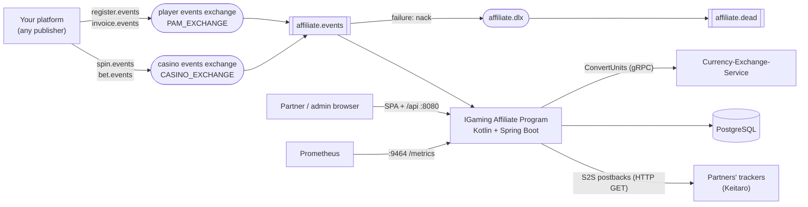

# Architecture

## Components

One process serves the Vue SPA and the REST API on `SERVER_PORT`, consumes RabbitMQ, runs a daily maintenance
job, and exposes metrics and health on `METRICS_PORT`. It keeps no state outside PostgreSQL except the in-memory
rate limits of sign-in and sign-up, so several replicas can run side by side.

## Code layout

Root package `io.github.nekzabirov.affiliate`, flat by concern; dependencies point `rest -> services -> db / clients
/ events`:

| Package | What lives there |
|---|---|
| `AffiliateApplication.kt` | `main` and the two launchers: `app` (default) and `schema` (Flyway, then exit) |
| `config/` | `AppProperties` (the app's own settings, validated at boot), the SPA, JSON, HTTP client, scheduling, RabbitMQ and gRPC channel configuration |
| `model/` | data classes and enums |
| `db/` | one store per table over Spring's `JdbcClient` and plain SQL, plus `StatsStore` for analytics reads |
| `events/` | the wire records, the strict envelope reader, the consumer, one handler per route |
| `services/` | one class per concern: accrual, auth, companies, payouts, postbacks, stats, `Money` (nano units), the daily `Maintenance` |
| `postback/` | the tracker adapters (`KeitaroAdapter`), `UrlGuard` (SSRF) and the guarded DNS resolver |
| `clients/` | `CurrencyClient` (Currency-Exchange-Service) |
| `rest/` | controllers, request and response records, the error handler, the session, trace and rate-limit filters |
| `errors/` | `DomainException(code, status)` and its subclasses |
| `frontend/` | the Vue 3 + Vite + Tailwind SPA, built into `src/main/resources/static` and served from the jar |

## Data model

All money is a signed `BIGINT` of nano units (1e-9) of `PARTNER_CURRENCY`; REST speaks decimal strings.

| Table | Holds |
|---|---|
| `account` | partners and admins: login, bcrypt hash, role, `active`, the one balance of all their companies |
| `session` | SHA-256 of each session token (the raw token lives only in the `ap_session` cookie), expiry |
| `company` | identity (the player's affiliate tag itself), owner, type (`CPA`, `REVSHARE_DEPOSIT`, `REVSHARE_TURNOVER`), amount or percent, status (`IN_REVIEW`, `ACTIVE`, `DISABLED`) |
| `postback` | a company's tracker URLs (at most 10) and the outcome of the last attempt |
| `referral` | a player attributed to a company: click id, attribution, country, registration and first deposit |
| `commission` | the earnings ledger, unique per source |
| `activity_daily` | per player and UTC day: deposits and real-money turnover |
| `processed_fact` | one row per event acted on: the idempotency key and what a stake added |
| `payout` | withdrawal requests: amount, network, address, status (`PENDING`, `PAID`, `REJECTED`), transaction hash, comment |

The schema is Flyway's (`src/main/resources/db/migration`), applied only by the `schema` launcher; the service
itself runs with Flyway off, so two replicas starting at once never race for the history table.

## Flows

- **Attribution and accrual**: [Events](Events) and [Commissions](Commissions).
- **Postbacks** go out after the database commit, on a bounded pool: [Postbacks](Postbacks).
- **Payouts**: a request reserves (debits) the amount in the same transaction that records it, so the same money
  cannot be requested twice; staff pay by hand and mark it ([Administration](Administration)).
- **Daily job** (03:17 UTC): deletes expired sessions and `spin:` idempotency keys older than 15 days, in batches.

## Guarantees

- Every event is acted on once, in one transaction with its effects; a failure leaves nothing behind and the
  event in `affiliate.dead`.
- No remote call (currency service, tracker, DNS) ever runs inside a database transaction.
- Every partner endpoint is scoped to the signed-in account: another partner's company answers 404, exactly like a
  missing one. `/api/admin/**` needs an admin (checked by the filter and again by the controller).
- Partner-supplied URLs are untrusted: the SSRF guard checks them when saved and again at connect time.
